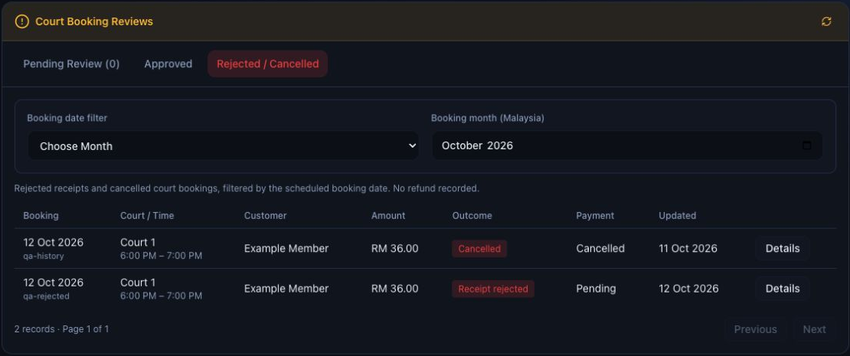
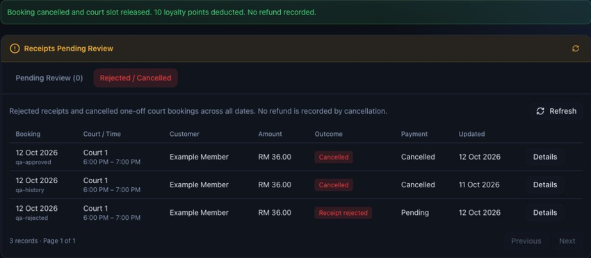
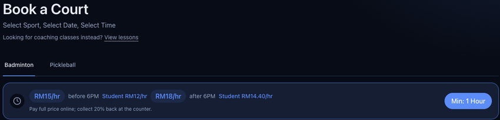
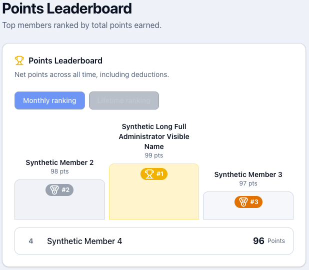
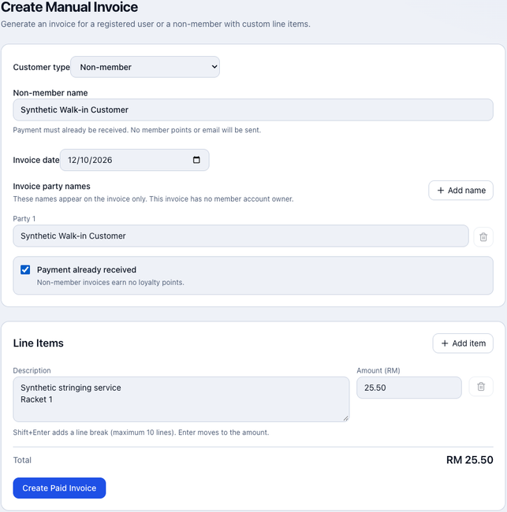
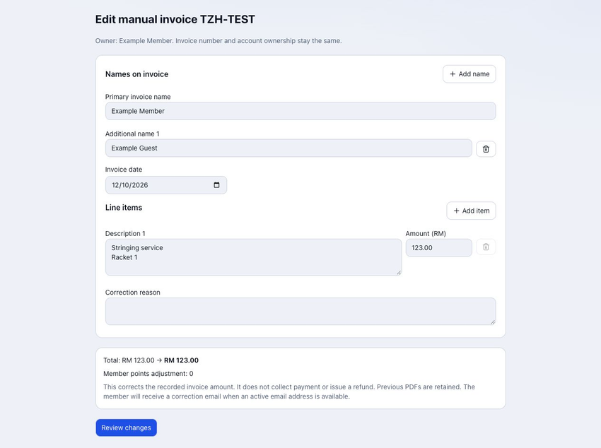

# Updates · 12–13 October 2026

[← All guides](README.md)

> Preview guide: live deployment has not been verified. Screenshots use sample records; some show an earlier layout. Confirm the controls appear on your live site before trying them.

## Browse approved bookings and history

**Open:** Admin → Schedule → Bookings

1. Under **Court Booking Reviews**, choose **Approved** or **Rejected / Cancelled**.
2. Choose **This Month**, **Choose Month**, or **All Dates**.
3. Click **Details** to inspect a booking.

Filters follow the scheduled booking date in Malaysia time. Older records remain available; history is read-only.

View screenshot

## Cancel an approved court booking

**Open:** Admin → Schedule → Bookings

1. Open an approved one-off booking from the timetable or **Approved** list.
2. Click **Edit → Cancel Booking**.
3. Check the details, then choose **No** or **Yes, cancel booking**.

Cancellation releases the slot and marks the booking and linked invoice cancelled. Eligible awarded points are deducted up to the available balance. **No refund is processed.**

View sample cancellation result

## See student court prices

**Open:** Book Court

1. Select **Badminton** or **Pickleball**.
2. Compare the regular and **Student** hourly rates above the calendar.
3. Select your slots and indicate student eligibility when booking.

**Pay the full online total; collect 20% back at the counter.** The eligibility checkbox does not reduce the online total.

View screenshot

## Switch rankings and see full names as an admin

**Open:** Memberships → Leaderboard

1. View **Monthly ranking**, the default.
2. Switch to **Lifetime ranking**.
3. Sign in as an admin to see full names. Regular users see masked names.

Monthly ranking uses net points this Malaysia calendar month; lifetime uses net points across all time. Both include deductions.

View sample admin leaderboard

## Create a paid manual invoice

**Open:** Admin → Invoices → Create Manual Invoice

1. Choose **Registered user** and search/select the account, or **Non-member** and enter the name.
2. Set the date; add optional printed names, items and RM amounts.
3. Check **Payment already received**, review the total, then click **Create Paid Invoice**.

The primary customer name stays first. Non-members receive no account, points or email. Use only for money already received.

View sample non-member invoice form

## Correct a manual invoice

**Open:** Admin → Invoices → Issued Invoices

1. Click **Edit** beside a manual invoice.
2. Correct the names, date or items; enter a **Correction reason**.
3. Click **Review changes**, check totals and points, then **Confirm correction**.

Invoice number and account owner stay fixed. Previous PDFs remain in **Correction history**. No payment or refund is processed. **Back to invoices** returns to Issued Invoices.

View sample correction form

## Check the About Us photo update

**Open:** About Us

Scroll to **“The craft behind every restring.”** The certificate presentation photo is now on the left; the previous left photo moves to the bottom right.

View the updated left photo

